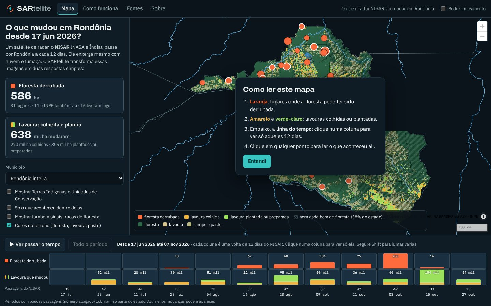

# SARtellite

**O que o radar NISAR viu mudar em Rondônia.**

Equipe **Astrópodes**, NASA Space Apps Challenge 2026 (Vilhena, RO), desafio **Dancing with the SARs**: uma aplicação interativa que usa o radar NISAR (NASA e ISRO) para acompanhar e mostrar mudanças na superfície da Terra.

O SARtellite responde a duas perguntas em linguagem simples, num mapa plano de Rondônia com linha do tempo:

1. **Onde a floresta foi derrubada?**
2. **Onde a lavoura foi colhida ou plantada?**

Os dois insights saem do NISAR. As outras fontes só dizem *onde* (SEDAM) e *conferem* (INPE).



> Protótipo de estudantes. Não representa nem é certificado pela NASA, ISRO, INPE ou SEDAM.

## Por que esses dois insights

- **Colher e derrubar mudam o radar do mesmo jeito.** Na primeira versão do projeto, a maior mudança de radar (Sentinel-1) no sul de RO era colheita, não desmatamento. Separar os dois pelo tipo de terreno evita o erro mais comum de quem usa radar.
- **Eles contam a história de Rondônia:** a floresta que vira campo e o campo que produz.
- **Rios, seca, fogo e deslizamento foram testados ou avaliados e descartados.** A água dos rios não muda o bastante na prévia de 180 m; seca não é medida direta; fogo não é dado de radar; deslizamento não é relevante no estado.

## O que o site faz

| Recurso | Situação |
|---|---|
| Mapa plano de Rondônia com cobertura do solo, municípios, rios, TIs e UCs | Pronto |
| Floresta derrubada: manchas com frase simples, data, lugar, tamanho em campos de futebol | Pronto |
| Grau de certeza: "O INPE também viu", "Provável", "Sinal fraco" (escondido por padrão) | Pronto |
| Gráfico do eco do radar no lugar e na floresta em volta, passagem a passagem | Pronto |
| Lavoura: quadrados de 1 km coloridos por colheita ou plantio | Pronto |
| Linha do tempo por volta de 12 dias do NISAR, com clique, arraste e reprodução | Pronto |
| Filtros: município, áreas protegidas, sinais fracos, cores do terreno | Pronto |
| Área sem dado bom de floresta marcada no mapa (38% do estado) | Pronto |
| Páginas Como funciona, Fontes (com a conferência honesta) e Sobre | Pronto |
| NISAR calibrado de 20 m (HDF5) | **Pendente**: exige Earthdata Login |
| NASA FIRMS direto | **Pendente**: exige MAP_KEY; o pipeline troca sozinho quando houver |

## Números (de `public/data/ro/meta.json`)

- **NISAR:** 412 passagens sobre Rondônia, 45 quadros, de 18 jun a 30 out 2026; 280 com polarização HV.
- **Floresta:**
  - 46 manchas detectadas; 31 mostradas (11 o INPE também viu, 20 prováveis), somando 586 ha.
  - 16 das 31 tiveram fogo perto.
- **Lavoura:** 638 mil ha mudaram; cerca de 270 mil colhidos e 305 mil plantados ou preparados (quadrados de 1 km com mais de 25% da lavoura mudando).
- **Conferência com o DETER:**
  - 11 de 46 manchas (24%) coincidem com alertas do INPE.
  - Pixel a pixel, 11% do que marcamos fica perto de um corte raso do DETER, e achamos só 2% dos polígonos do DETER.
  - Motivo: a prévia pública tem 8 bits e 180 m. Está escrito na página Fontes.

## Rodar

```bash
npm install
npm run dev        # http://localhost:5173
npm test           # 10 testes: períodos, filtros, regras de cautela, linguagem
npm run build      # checa tipos e gera dist/
npm run preview    # http://localhost:4173
```

Site estático, sem chave nem servidor. `dist/` tem cerca de 3 MB. Funciona sem internet.

## Publicar

`base: './'` no Vite.

- **Vercel:** importe o repositório (o `vercel.json` já está pronto) ou rode `npx vercel --prod`.
- **Netlify:** importe o repositório (o `netlify.toml` já está pronto) ou arraste `dist/` em app.netlify.com/drop.
- **Na banca, sem internet:** `npm run build && npm run preview`.

## Refazer os dados

```bash
pip install -r pipeline/requirements.txt
bash pipeline/rondonia/run_all.sh       # 30 a 40 minutos
# opcional: FIRMS_MAP_KEY=... para usar o NASA FIRMS no lugar do INPE
```

| Script | O que faz |
|---|---|
| `r01_nisar_inventory.py` | Lista as passagens NISAR GCOV no NASA CMR e baixa as prévias HH e os KML públicos |
| `r01b_nisar_hv.py` | Baixa as prévias HV (dupla polarização) |
| `r02_context.py` | SEDAM (municípios, TIs, UCs), INPE DETER, cobertura do solo 10 m |
| `r03_fires.py` | Focos de calor (FIRMS com chave; INPE sem chave) |
| `r04_georef.py` | Grade de cada quadro: KML da ASF ou ajuste por correlação com o mapa de floresta (erro máximo de 1 px nos quadros conhecidos) |
| `r05_change.py` | Põe todas as passagens na grade do estado (UTM 20S, 180 m) |
| `r06_detect.py` | Detecção de floresta (HV) e lavoura (HH) + conferência com DETER |
| `r07_events.py` | Eventos com frase, lugar, certeza, série do radar e pistas |
| `r08_basemap.py` / `r09_meta.py` | Mapa base, área sem cobertura e resumo |

A regra da floresta está em [DATA_PROVENANCE.md](DATA_PROVENANCE.md). A primeira versão (antes e depois em duas áreas, com Sentinel) está em `pipeline/*.py` e `legacy/`, só como histórico.

## Limites

- Mudança de sinal não é causa. O site não diz quem fez nem se foi legal.
- Dentro de Terra Indígena ou UC, só aparece como provável o que o INPE também viu.
- O radar não é raio X: não vê pessoas, máquinas ou cargas sob as árvores.
- "Plantio" também pode ser solo preparado ou molhado pela chuva.

## Equipe e créditos

Leo, Bryan, Wellington e Diogo. Pitch em [PITCH.md](PITCH.md).

NISAR: NASA/JPL-Caltech e ISRO, via ASF DAAC. Cobertura do solo: Impact Observatory, Microsoft e Esri. SEDAM-RO, IBGE, FUNAI, ICMBio. INPE (DETER e Programa Queimadas). Natural Earth. MapLibre GL JS.
