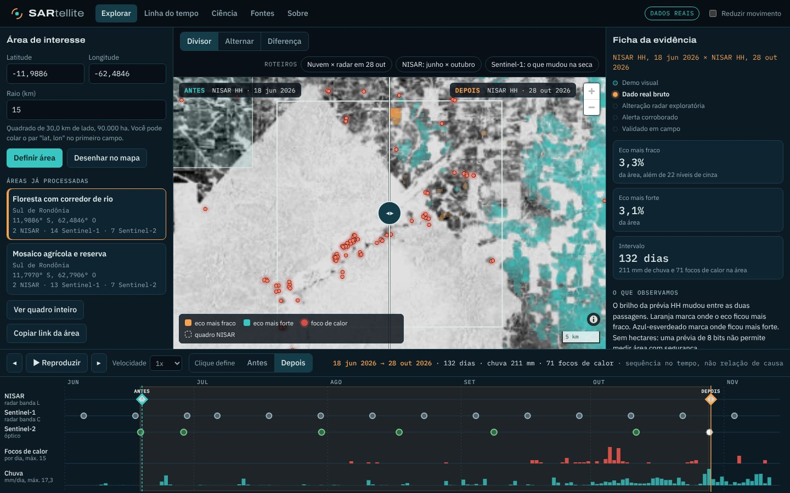

# SARtellite

**A floresta muda. Mesmo quando as nuvens escondem.**

Observatório interativo de mudanças em floresta e água com radar NISAR, Sentinel-1, Sentinel-2 e contexto de clima.
Equipe **Astrópodes**, NASA Space Apps Challenge 2026 (Vilhena, RO), desafio **Dancing with the SARs**.

O usuário informa uma coordenada, delimita uma área e percorre uma linha do tempo de passagens reais de satélite. O mapa compara antes e depois, mostra onde o sinal de radar mudou e diz, para cada resultado, de onde ele veio e até onde dá para confiar.

> Protótipo de estudantes. Não representa a NASA, a ISRO, a ESA ou o INPE e não é certificado por nenhuma delas.



## O que já funciona

| Recurso | Situação |
|---|---|
| Globo 3D manipulável com voo até Rondônia | Pronto (MapLibre GL, projeção globo, NASA Blue Marble embutido) |
| Coordenadas com validação, raio, retângulo desenhado com mouse ou toque | Pronto |
| Checagem de cobertura: dentro, na borda ou fora do quadro NISAR | Pronto |
| Linha do tempo com datas reais por sensor, reprodução, teclado | Pronto |
| Antes e depois: divisor arrastável, alternar, diferença | Pronto |
| Diferença Sentinel-1 em dB entre duas datas quaisquer, calculada no navegador | Pronto |
| Camadas: alteração, alteração com dois sensores, floresta, água, água histórica, focos, chuva | Pronto |
| Ficha da evidência: o que observamos, o que pode indicar, como confirmar, processamento, fonte | Pronto |
| Explicação animada de como o SAR enxerga, com banda L e banda C | Pronto |
| Funciona sem internet (dados e mapa base embutidos) e sem WebGL (comparação simples) | Pronto |
| NISAR calibrado em dB a partir dos HDF5 | **Pendente**: script escrito, não testado sem os arquivos |
| NASA FIRMS, GPM IMERG, Meteomatics | **Não conectados** (exigem chave ou servidor). A interface diz isso |

## O que é real aqui

Nada é simulado. Tudo foi baixado de catálogos públicos em 14 nov 2026 pelos scripts de `pipeline/`. Detalhes por dataset em [DATA_PROVENANCE.md](DATA_PROVENANCE.md).

- **NISAR**: os dois granules GCOV que a equipe identificou existem no catálogo da ASF e cobrem o centro-sul de Rondônia (trilha 068, quadro 094, descendente, 18 jun e 28 out 2026). Usamos a **prévia pública HH** de cada um: 8 bits, 180 m por pixel. É dado real da missão, mas não é o dB calibrado do HDF5. Por isso a diferença NISAR não tem hectares.
- **Sentinel-1 RTC** e **Sentinel-2 L2A** (Planetary Computer): calibrados, 20 m, em duas áreas de 30 km.
- **Focos de calor**: INPE Queimadas (detecções MODIS e VIIRS), 3.306 focos de satélites polares no quadro entre jun e nov 2026.
- **Chuva**: NASA POWER, diária.
- **Referência**: cobertura do solo Impact Observatory 2023 e água histórica JRC.

### Três achados que a demo mostra

1. **No dia 28 out 2026, o Sentinel-2 viu 100% de nuvem sobre as duas áreas. O NISAR passou oito horas depois e registrou a superfície.**
2. **A maior mudança de radar do quadro não é desmatamento.** No mosaico agrícola, 6.151 ha tiveram queda de VH acima de 3 dB entre 22 jun e 8 nov. Desses, 5.910 ha estão em lavoura e pastagem, e 71% coincidem com queda de NDVI no óptico. É colheita e solo preparado.
3. **Na área de floresta**, a prévia NISAR escurece ao longo de um corredor de rio onde o INPE registrou 71 focos de calor no intervalo. O Sentinel-1 e o Sentinel-2 concordam em 77,5 ha. Causa não determinada.

Outro cuidado que os dados mostram: nos 30 dias antes da cena de junho choveu 3 mm; antes da de outubro, 128 mm. Solo úmido muda o eco.

## Rodar

Requer Node 20 ou mais recente.

```bash
npm install
npm run dev        # http://localhost:5173
npm test           # 16 testes de coordenadas, cobertura, linha do tempo e dB
npm run build      # checa tipos e gera dist/
npm run preview    # serve dist/ em http://localhost:4173
```

O site é estático. Não usa chave, banco de dados nem servidor. `dist/` tem cerca de 19 MB, quase tudo imagens de satélite.

## Publicar

`base: './'` no Vite: o build funciona em qualquer subpasta.

**Vercel**: importe o repositório em vercel.com/new. O `vercel.json` já define `npm run build` e a pasta `dist`. Ou, pelo terminal: `npx vercel --prod`.

**Netlify**: importe o repositório em app.netlify.com. O `netlify.toml` já define o build. Ou arraste a pasta `dist/` para app.netlify.com/drop.

**GitHub Pages**: Settings, Pages, Source "GitHub Actions", modelo "Static HTML" apontando para `dist/` depois de `npm ci && npm run build`.

**Sem internet, na banca**: `npm run build && npm run preview` e abra `http://localhost:4173`.

## Arquitetura

```
pipeline/ (Python)                 public/data/                src/ (Vite + React + TypeScript)
  01 ASF: granules e prévias  ──►   manifest.json         ──►   lib/data.ts     carrega e unifica cenas
  02 georreferência NISAR           nisar/*.webp                lib/geo.ts      coordenadas e cobertura
  03 Sentinel-1 RTC                 <area>/s1/*.webp            lib/delta.ts    diferença em dB no navegador
  04 Sentinel-2 L2A                 <area>/s2/*.webp|png        lib/evidence    texto da ficha por comparação
  05 focos INPE + chuva POWER       fires.json                  MapStage        dois mapas sincronizados (globo)
  06 floresta e água de referência  <area>/ref/*.png            Timeline        eixo de tempo em SVG
  07 mapa base offline              tiles/, basemap.json     Panels, EvidenceCard, SarExplainer
  08 análise cruzada + manifest     <area>/analysis/*.png
```

O frontend só lê `manifest.json`. Campo ausente é `null`, nunca zero. Cada cena carrega `product_id`, `acquired_at`, `source_url`, `evidence` e `is_synthetic: false`.

### Refazer os dados ou adicionar uma área

```bash
pip install -r pipeline/requirements.txt
# edite AOIS em pipeline/config.py (centro em lon/lat, dentro do quadro NISAR)
bash pipeline/run_all.sh     # cerca de 20 minutos
```

### Trocar a prévia NISAR pelo dado calibrado

1. Crie a conta gratuita em https://urs.earthdata.nasa.gov/ e baixe os dois HDF5 (links em Fontes ou no `manifest.json`, campo `h5_url`).
2. `python pipeline/inspecionar_nisar_gcov.py arquivo.h5` para conferir datasets e EPSG.
3. `SART_AOI=ro-sul-floresta python pipeline/nisar_gcov_change.py antes.h5 depois.h5`.
4. O script exporta HH em dB e a área por limiar. Ele **ainda não foi testado com os arquivos reais**.

## Limites que o site declara

- Mudança de sinal não é causa. O radar não diz se foi corte, fogo, colheita ou chuva.
- O radar não é raio X. Não vê pessoas, veículos ou cargas sob as árvores.
- Banda L e banda C não são subtraídas uma da outra.
- Limiar de 3 dB é experimental. Os números para 2 e 4 dB estão em DATA_PROVENANCE.md.
- Foco de calor não é área queimada. Chuva do POWER tem cerca de 50 km de resolução.
- Nada foi validado em campo.

## Testes feitos

- `npm test`: 16 testes passam.
- `npm run build`: sem erros de tipo.
- Navegador headless (Chrome, 1440x900 e 390x844): abertura, voo, três roteiros, coordenada inválida, fora do quadro, dentro do quadro, retângulo desenhado, reprodução, camadas, páginas Ciência e Fontes. Sem erros no console e sem rolagem lateral no celular.
- Não testado: Safari, leitor de tela, celulares reais.

## Equipe

Leo, Bryan, Wellington e Diogo. O pitch está em [PITCH.md](PITCH.md).

## Créditos de dados

Contém dados Copernicus Sentinel modificados (2026). NISAR: NASA/JPL-Caltech e ISRO, distribuído pela ASF DAAC. Focos: INPE, Programa Queimadas. Chuva: NASA POWER. Cobertura do solo: Impact Observatory, Microsoft e Esri. Água histórica: JRC/Google. Mapa base: NASA GIBS Blue Marble e Natural Earth. Mapas: MapLibre GL JS.
