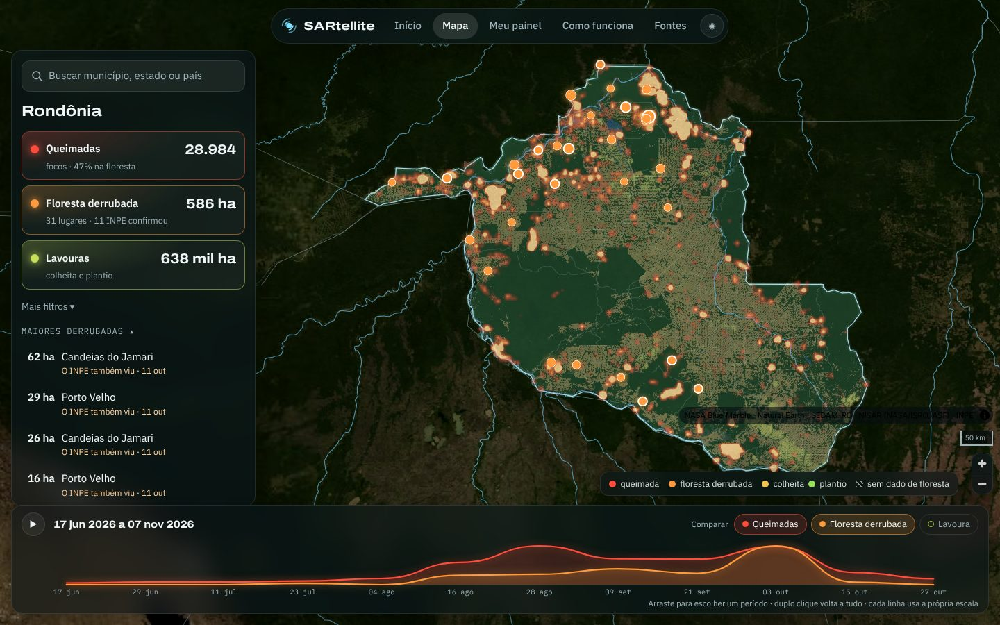

# SARtellite

**O que o radar NISAR viu mudar em Rondônia.**

Equipe **Astrópodes**, NASA Space Apps Challenge 2026 (Vilhena, RO), desafio **Dancing with the SARs**: uma aplicação interativa que usa o radar NISAR (NASA e ISRO) para acompanhar e mostrar mudanças na superfície da Terra.

O SARtellite mostra três mudanças de Rondônia em linguagem simples, num mapa em tela cheia com linha do tempo:

1. **Queimadas** (focos de calor do INPE: contexto de quando e onde houve fogo)
2. **Floresta derrubada** (radar NISAR, polarização HV)
3. **Lavoura colhida ou plantada** (radar NISAR, polarização HH)

O herói é o NISAR: ele enxerga através de nuvem e fumaça, justamente na seca, quando o fogo e a derrubada acontecem. A narrativa do pitch (El Niño 2026 → Amazônia → Rondônia) está em [PITCH.md](PITCH.md), e **todas as fontes e referências** em [FONTES_E_REFERENCIAS.md](FONTES_E_REFERENCIAS.md).



> Protótipo de estudantes. Não representa nem é certificado pela NASA, ISRO, INPE ou SEDAM.

## Páginas

| Página | O que tem |
|---|---|
| **Início** | Frase curta, três números ao vivo (clicáveis), a história em 5 tempos e para quem serve |
| **Mapa** | Fundo NASA Blue Marble do mundo todo, voo de abertura até RO, camadas Queimadas / Floresta / Lavoura com calor de longe e pontos de perto, busca de municípios, estados e países, filtros, cartão de detalhe com o eco do radar, lista das maiores derrubadas |
| **Linha do tempo** | O usuário escolhe o que comparar (chips); cada série na própria escala; arrastar escolhe período, duplo clique volta a tudo, botão de reprodução |
| **Fora de RO** | Cartão "Demonstração" com lentes futuras (alagamentos, seca dos rios). Nenhuma mancha falsa no mapa |
| **Meu painel** | Demonstração: perfil (produtor, prefeitura, comunidade), municípios seguidos com números reais, avisos (em breve), cartão EUDR para o produtor. Fica só no navegador |
| **Como funciona** | Explicador animado do radar e o que dá e não dá para dizer |
| **Fontes** | Tabela de fontes e a conferência honesta com o INPE |

## Números (de `public/data/ro/meta.json`)

- **NISAR:** 412 passagens sobre Rondônia, 45 quadros, de 18 jun a 30 out 2026; 280 com polarização HV.
- **Queimadas:** 28.984 focos (INPE, 17 jun a 7 nov 2026), 47% em floresta.
- **Floresta:** 46 manchas detectadas; 31 mostradas (11 o INPE também viu, 20 prováveis), somando 586 ha.
- **Lavoura:** 638 mil ha mudaram (quadrados de 1 km).
- **Conferência com o DETER:** 11 de 46 manchas (24%) coincidem; pixel a pixel, 11% de precisão perto de corte raso e 2% dos polígonos achados. Motivo: prévia pública de 8 bits e 180 m. Está na página Fontes.

## Rodar

```bash
npm install
npm run dev        # http://localhost:5173
npm test           # 15 testes: períodos, filtros, queimadas, busca, regras de cautela, linguagem
npm run build      # checa tipos e gera dist/
npm run preview    # http://localhost:4173
```

Site estático, sem chave nem servidor. Funciona sem internet (o fundo do mapa vem junto em `public/data/tiles`).

## Publicar

`base: './'` no Vite.

- **Vercel:** importe o repositório (o `vercel.json` já está pronto) ou rode `npx vercel --prod`.
- **Netlify:** importe o repositório (o `netlify.toml` já está pronto) ou arraste `dist/` em app.netlify.com/drop.
- **Na banca, sem internet:** `npm run build && npm run preview`.

## Refazer os dados

```bash
pip install -r pipeline/requirements.txt
bash pipeline/rondonia/run_all.sh       # 30 a 40 minutos
# opcional: FIRMS_MAP_KEY=... para usar o NASA FIRMS no lugar do INPE
```

| Script | O que faz |
|---|---|
| `r01_nisar_inventory.py` | Lista as passagens NISAR GCOV no NASA CMR e baixa as prévias HH e os KML públicos |
| `r01b_nisar_hv.py` | Baixa as prévias HV (dupla polarização) |
| `r02_context.py` | SEDAM (municípios, TIs, UCs), INPE DETER, cobertura do solo 10 m |
| `r03_fires.py` | Focos de calor (FIRMS com chave; INPE sem chave) |
| `r04_georef.py` | Grade de cada quadro: KML da ASF ou ajuste por correlação com o mapa de floresta (erro máximo de 1 px nos quadros conhecidos) |
| `r05_change.py` | Põe todas as passagens na grade do estado (UTM 20S, 180 m) |
| `r06_detect.py` | Detecção de floresta (HV) e lavoura (HH) + conferência com DETER |
| `r07_events.py` | Eventos com frase, lugar, certeza, série do radar e pistas |
| `r08_basemap.py` / `r09_meta.py` | Mapa base, área sem cobertura e resumo |
| `r10_web.py` | Focos para a web (só dentro dos períodos do NISAR), contornos suaves, busca de lugares, ladrilhos Blue Marble e imagem da capa |

A regra da floresta está em [DATA_PROVENANCE.md](DATA_PROVENANCE.md). A primeira versão (antes e depois em duas áreas, com Sentinel) está em `pipeline/*.py` e `legacy/`, só como histórico.

## Limites

- Mudança de sinal não é causa. O site não diz quem fez nem se foi legal.
- Dentro de Terra Indígena ou UC, só aparece como provável o que o INPE também viu.
- O radar não é raio X: não vê pessoas, máquinas ou cargas sob as árvores.
- "Plantio" também pode ser solo preparado ou molhado pela chuva.

## Equipe e créditos

Leo, Bryan, Wellington e Diogo. Pitch em [PITCH.md](PITCH.md). Fontes em [FONTES_E_REFERENCIAS.md](FONTES_E_REFERENCIAS.md).

NISAR: NASA/JPL-Caltech e ISRO, via ASF DAAC. Cobertura do solo: Impact Observatory, Microsoft e Esri. SEDAM-RO, IBGE, FUNAI, ICMBio. INPE (DETER e Programa Queimadas). NASA Blue Marble. Natural Earth. MapLibre GL JS.
